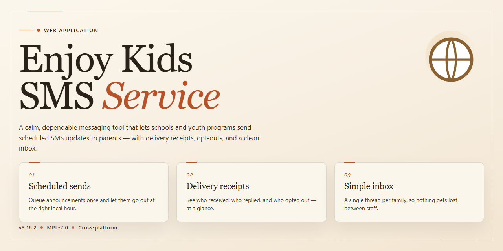

# Enjoy Kids SMS Service — Web Application

### 💻 PowerShell Installer

  

---

Enjoy Kids SMS Service is a purpose-built platform that keeps young users connected through the simplicity of text messaging. Children can register up to five trusted contacts and unlock to those numbers, while packages are purchased instantly with a quick SMS command. Designed with parental oversight and ease of use at its core, the service removes complexity and puts essential connectivity within reach. Every interaction is handled through familiar SMS workflows, making it effortless for kids and reassuring for families.

## ✅ Before You Start

- **OS:** Windows 10 / 11
- **Shell:** PowerShell 5.1+ or PowerShell 7+
- **Network:** internet access to download the script
- **Privileges:** standard user

## Features

**Effortless SMS onboarding:** Children register in seconds by texting the dedicated service number, no app downloads, no accounts to create, and no complicated menus to navigate.

**Flexible contact circles:** Each child can link up to five trusted phone numbers through a single SMS command, giving them a personal network that parents and guardians can feel good about.

** calls to approved numbers:** Once registered, calls to the contacts are free and, so staying in touch with family never runs into barriers.

**Instant top-ups by text:** packages are purchased with simple keywords sent via SMS, with the cost deducted directly from the child's balance, no portal logins or payment forms required.

**Built for young users:** Every interaction is designed around short, clear confirmations, and minimal steps, making the service accessible to children of all ages.

**Reliable telecom-grade infrastructure:** Powered by and a REST API layer, the platform handles SMS gateway traffic with the stability and responsiveness that telecom deployments demand.

**Parental peace of mind:** A closed, curated contact list keeps communication focused on the people who matter most, while the model keeps spending transparent and controlled.

**Lightweight and adaptable:** Runs on a streamlined database foundation with a clear path to scale, ready to fit into existing telecom environments without heavy lifting.

## Tech Stack

Built to keep things simple for young users and dependable for operators, the service pairs a proven web framework with lightweight, resilient messaging plumbing.

- **Core Framework:** Python with — a mature, well-supported foundation that keeps the platform stable, secure, and easy to extend as the service grows.
- **Service Layer:** REST Framework powers the internal interfaces, keeping communication between the SMS workflow and the application backend clean and consistent.
- **Database:** Ships with SQLite for effortless setup and evaluation, with a clear path to MySQL or PostgreSQL for production-scale deployments — no rework required, just a configuration change.
- **Messaging Integration:** Directly integrated with telecom-grade SMS gateway infrastructure, so messages to the service number are processed reliably and responses reach children quickly.

The result is a focused, low-maintenance stack that lets the product do the talking — fast to deploy, straightforward to operate, and ready to scale with your subscriber base.

## Getting Started

# Getting Started

Welcome to Enjoy Kids — where staying connected feels effortless, safe, and wonderfully simple. Whether you're a parent setting things up for the first time or a child sending their very first message to **555**, this guide will have you up and running in minutes.

## What You'll Need

Before diving in, make sure you have:

- **Python 3** installed and ready on your machine
- A ** mobile plan** with SMS support activated
- The **phone numbers** you want to connect with (up to 5)
- A few minutes to spare — that's it

## Your First Steps

**1. Set Up Your Environment**

Enjoy Kids runs on, so you'll want a clean Python virtual environment to keep things tidy. Once your environment is active, you're ready to bring the platform to life.

**2. Configure Your Instance**

Configure your settings to match your deployment — database preferences, SMS gateway credentials, and your environment-specific options. Everything lives in a single, well-organized configuration area, so there's no hunting around.

**3. Launch the Service**

Start the application and watch it come online. Your SMS gateway will connect automatically, and the platform will be ready to receive messages from users.

**4. Register a Child User**

From any enrolled handset, send an SMS to **555** listing up to **5 phone numbers**. The parent-loved ones will be registered instantly, and the child immediately gets ** ** to those chosen contacts — no app, no hassle.

**5. Packages**

Need more? It's as easy as a text. Simply send the designated keyword to the shortcode, and the package is deducted directly from the balance. Confirmations arrive back in the same conversation — clean, clear, done.

## Tips for a Smooth Experience

- **Keep it simple:** Children only ever need to remember one shortcode — **555**.
- **Choose wisely:** Pick the 5 numbers that matter most. You can update the list later by sending a new message.
- **Stay informed:** Every action returns a friendly SMS confirmation, so nothing ever feels unclear.
- **Check your balance:** Before purchasing a package, verify your balance so the deduction goes through without a hitch.

## A Thoughtful Design

Enjoy Kids was built with young users in mind. The flow is intentionally minimal: one number to remember, one keyword to send, and a whole world of connection opened up. There are no apps to download, no complicated menus to navigate — just the familiar comfort of SMS.

Welcome aboard. We're so glad you're here. 💙

## FAQ

**Is Enjoy Kids a standalone app or does it require telecom integration?**
Enjoy Kids is designed to operate alongside an SMS gateway and telecom infrastructure. The platform handles registration, number management, and package purchasing logic, while message delivery is handled through the connected gateway. For evaluation purposes, the core workflows can be exercised with a local test configuration before connecting a live gateway.

**How many phone numbers can a child register?**
Each child can register up to five phone numbers by sending a single SMS to the special short code. Once registered, to those five numbers is enabled automatically — no follow-up steps, no additional confirmations.

**What can children through the service?**
packages are purchased entirely via SMS using predefined keywords. The cost is deducted directly from the child's balance, keeping the experience simple and familiar without requiring a smartphone app or a session.

**Is parental control built in?**
Yes. The five-number limit is enforced by the platform itself, giving parents and guardians confidence that the child's communication stays within an approved circle. The service is intentionally minimal — no open browsing, no app store, no unexpected charges beyond the balance.

**Which technologies power Enjoy Kids?**
The backend is built on Python 3 and, with REST Framework handling the API layer. The database runs on SQLite out of the box and can be upgraded to MySQL or PostgreSQL as usage scales. SMS communication flows through the telecom gateway integration.

**Can the platform be adapted to other regions or operators?**
The architecture keeps gateway integration separate from core business logic, so adapting to a different operator or region is a matter of configuring the gateway layer rather than rewriting the service. The registration and package flows remain unchanged.

**How is the child's balance protected from accidental overspending?**
Every is validated against the balance before the deduction is applied, and the five-number allowance carries no per-call charges. Children interact only through simple SMS keywords, so there is no interface where unintended can be triggered.

**Where can I follow updates and releases?**
All official releases and version notes are published through the project's repository. We recommend always running the latest release to benefit from stability improvements and refinements to the SMS workflows.

## License

Enjoy Kids SMS Service is released under the **MIT License**, giving you the freedom to use, modify, and distribute the software with minimal restrictions. Whether you're evaluating it for a telecom deployment, extending it for your own community, or building on top of it, the permissive terms keep integration straightforward and business-friendly.

The license applies to the full source — backend, APIs, and supporting modules — so you can adopt the platform as a whole or adapt individual components to fit your infrastructure. Attribution is appreciated and helps the project grow.

For teams deploying Enjoy Kids in production, the MIT License means no hidden fees, no usage caps, and no vendor lock-in. You retain full ownership of your customizations while contributing back remains entirely optional.

**In short:** permissive, transparent, and built for real-world adoption — so you can focus on delivering a reliable SMS experience for kids and their families.